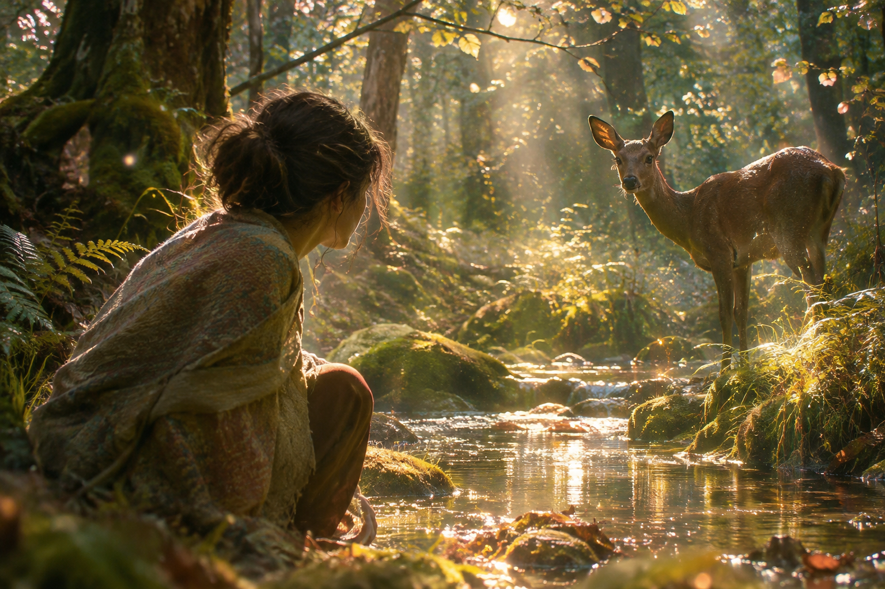

Elle s'accroupit.

Les traces venaient de plusieurs directions.  
Certaines s'enfonçaient dans les fourrés, d'autres rejoignaient la source.  
Elles dessinaient autour de l'eau un réseau de passages qu'elle n'avait jamais soupçonné.

Au moment où elle se releva, le chevreuil apparut de l'autre côté du ravin.

Il s'approcha de l'eau, baissa la tête et but longuement.  
La femme demeura immobile.

Alors elle comprit que la clairière où elle l'avait tant attendu n'était  
qu'une halte sur un chemin beaucoup plus vaste.  
L'animal ne venait pas y chercher quelqu'un.  
Il suivait sa propre vie, ses besoins, ses saisons,  
selon une géographie que la femme ne connaissait pas.

Cette découverte lui serra le ventre.  
Elle aurait aimé que leurs rencontres aient une autre signification, qu'il existe  
entre eux quelque chose qu'elle aurait pu reconnaître dans le regard de l'animal.

Mais le chevreuil ne lui devait aucun signe.

Il releva la tête, huma l'air, puis s'éloigna entre les noisetiers.

La femme resta près de la source.  
Elle éprouvait une émotion étrange, faite à la fois de douceur et de déchirement.  
Ce qu'elle avait ressenti ne devenait pas moins réel parce que l'animal l'ignorait.  
Peut-être même était-ce là qu'elle devait en découvrir la véritable nature.

Elle n'avait pas besoin d'être attendue pour avoir été touchée.

Le printemps revint. Les premières fleurs apparurent sous les hêtres.  
La femme empruntait désormais d'autres sentiers.  
Elle continuait parfois de passer par la clairière,  
mais ne s'y attardait plus dans l'espoir d'y retrouver le chevreuil.

Un matin, elle le vit de l'autre côté du vieux mur. Un petit l'accompagnait.  
Il avançait maladroitement dans les herbes nouvelles, revenait vers l'adulte, puis repartait.

La femme posa la main sur un hêtre.  
Son cœur battait encore un peu plus vite.  
Elle sourit, sans chercher à réduire la distance.

Les deux silhouettes disparurent derrière les arbres.

Elle allait reprendre sa marche lorsqu'une odeur lui parvint.  
Une odeur de terre profonde, de mousse et de quelque chose de plus ancien,  
qu'elle avait déjà sentie près de la source.

Elle se retourna.

À l'endroit où le chevreuil venait de disparaître, les feuilles remuaient doucement.  
Pourtant, aucun souffle ne traversait la clairière.

Puis elle entendit trois coups légers, espacés,  
comme si quelqu'un frappait de l'autre côté d'une porte invisible.

Elle s'approcha du vieux hêtre.

Dans son écorce, à hauteur de ses yeux, une petite cavité s'ouvrait.  
Elle ne l'avait jamais remarquée.  
Au fond reposait une feuille verte, parfaitement intacte,  
bien qu'aucune branche ne fût assez proche pour l'avoir laissée tomber là.

Elle tendit la main, puis s'arrêta.

De l'autre côté du tronc, quelque chose respirait.

Elle n'entendait ni pas ni mouvement, seulement un souffle lent,  
presque confondu avec celui du bois.

Alors elle comprit qu'il existait des présences que l'on ne rencontrait pas en s'approchant,  
et des portes que l'on ne franchissait pas en avançant.

Elle retira sa main.

Lorsqu'elle reprit le chemin de la maison, le soleil avait disparu derrière les grands arbres.  
La forêt retrouvait ses ombres, ses murmures et ses passages secrets.

Elle ne savait pas ce qu'elle avait découvert.

Elle savait seulement que, depuis ce jour, elle ne traverserait plus jamais le bois tout à fait de la même manière.

Et parfois, au détour d'un sentier, lorsqu'une odeur de mousse et de terre humide venait effleurer son visage, elle s'arrêtait.

Elle restait parce qu'elle avait senti quelque chose d'indéfinissable :  

comme si, l'espace d'un instant, le monde s'était adressé à elle.

---

© Céleste R.
