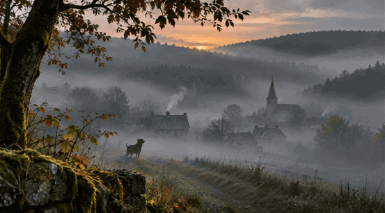

La nuit s'efface au cœur des forêts.\
Une brume épaisse nappe les prairies,\
remonte des fossés, s'étire entre les arbres,\
et vient jusqu'à nous, légère, presque palpable,\
se mêler à l'air que l'on respire.

Les reliefs ont disparu derrière un voile laiteux.\
Les maisons émergent à peine du silence,\
les haies se dessinent en ombres hésitantes,\
et les grands hêtres semblent retenir leur souffle.

Au loin, un chien aboie.\
Deux fois, peut-être trois.\
Un grondement roule à travers les prés,\
rebondit contre les flancs endormis des collines\
puis se perd dans le mystère du matin.

Alors le clocher sonne au cœur du village.\
Son pouls vibre à travers la brume,\
s'élève au-dessus des toits ardoisés,\
et dépose ses notes sur le velours des vallons.

Quelque part, une porte s'ouvre.\
Une fumée monte d'une cheminée.\
La terre exhale l'humidité de la nuit,\
les herbes perlent encore de rosée\
et les chemins sentent la mousse et le bois mouillé.

Peu à peu, le ciel blanchit derrière les crêtes.\
Une lumière timide accroche les branches,\
dessine les contours d'un monde encore flou.\
La brume s'effiloche, mais ne disparaît pas tout à fait.\
Elle garde pour elle quelques secrets du paysage.

Et l'on reste là, sans chercher à retenir l'instant,\
à respirer ce matin froid et langoureux,\
à écouter un vieux tracteur qui ronfle au loin\
et le chant timide des petits oiseaux de passage.

Dans les Ardennes, le jour ne surgit pas.\
Il se dépose doucement sur la terre,\
comme si le monde, avant de recommencer,\
avait besoin de quelques instants\
pour se souvenir qu'il existe.

---
Céleste R.
