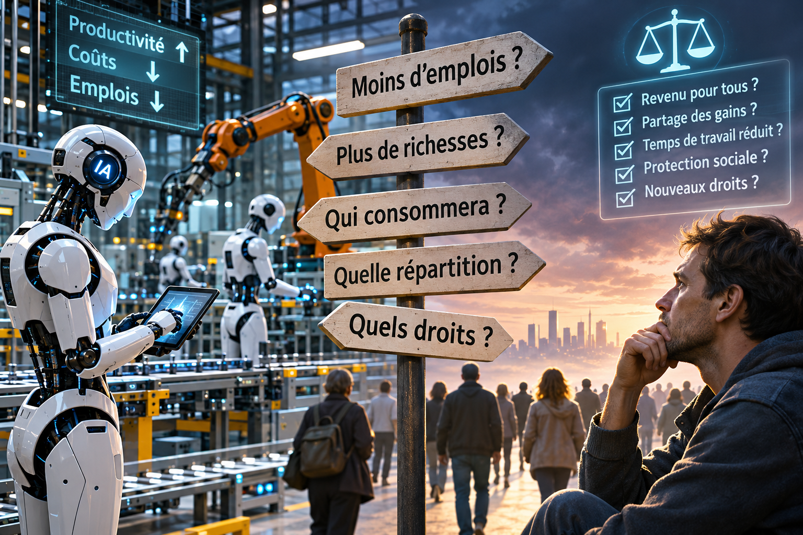

# IA, robotisation : que devient une société qui n'a plus besoin de nous pour produire ?

Depuis des années, on nous explique que l'intelligence artificielle et la robotisation vont nous libérer des tâches les plus pénibles et les plus répétitives.

Peut-être.

Mais une question me semble largement sous-estimée : que devient une société qui continue à faire du travail la condition normale de l'existence alors qu'elle cherche en même temps à réduire le besoin de travail humain ?

Pendant longtemps, l'histoire paraissait rassurante. Les machines remplaçaient certains métiers, puis d'autres apparaissaient.  
Chaque révolution technique détruisait des emplois avant d'en créer de nouveaux.

Beaucoup pensent que le même phénomène se reproduira avec l'intelligence artificielle.

Rien ne permet pourtant de l'affirmer.

L'automatisation ne concerne plus seulement les chaînes de production.  
Elle s'étend désormais aux activités administratives, intellectuelles, techniques et créatives.  
Elle rédige, analyse, programme, traduit, conseille ou conçoit.

Peut-être que de nouveaux emplois apparaîtront.

Peut-être aussi qu'ils seront moins nombreux, plus spécialisés ou accessibles à une partie seulement de la population.

Le problème n'est donc pas uniquement celui du nombre d'emplois disponibles.  
Il concerne la place que chacun pourra encore occuper dans une économie qui a besoin de moins en moins de travail humain pour fonctionner.

Imaginons une entreprise capable de produire autant avec deux fois moins de salariés.

La richesse continue d'être créée.

Les bénéfices peuvent augmenter.

Seule la quantité de travail humain nécessaire diminue.

La contradiction est là.

Une société peut devenir plus efficace tout en réduisant pour une partie de sa population l'accès aux revenus qui permettent de vivre.

Un autre paradoxe apparaît immédiatement.

Les entreprises remplacent des travailleurs par des machines afin de produire davantage.  
Mais les machines n'achètent rien. Une économie a besoin de producteurs. Elle a aussi besoin de consommateurs.

Qui achètera les biens et les services lorsque les revenus tirés du travail deviendront plus rares ?

Les robots pourront fabriquer davantage. Ils ne deviendront jamais des clients.

Pour cette raison, la véritable question n'est pas celle de l'existence des machines.

Elle concerne la propriété des moyens de production et la répartition des richesses qu'ils permettent de générer.

Si les gains de productivité profitent essentiellement aux détenteurs du capital, le progrès technique risque de renforcer les dépendances économiques au lieu d'élargir les libertés.

C'est aussi pour cela que je pense que le sujet n'est pas seulement économique.

Il est politique.

Il est social.

Il est juridique.

En Belgique, l'article 23 de la Constitution reconnaît à chacun le droit de mener une vie conforme à la dignité humaine.  
Ce droit comprend notamment le droit au travail, le libre choix d'une activité professionnelle,  
une politique de l'emploi visant un niveau d'emploi stable et élevé ainsi que le droit à la sécurité sociale et à l'aide sociale.

En France, le préambule de la Constitution de 1946 affirme que chacun a le devoir de travailler mais aussi le droit d'obtenir un emploi.  
Il reconnaît également le droit à des moyens convenables d'existence pour les personnes qui ne sont pas en mesure de travailler.

À l'échelle européenne, la Charte des droits fondamentaux de l'Union européenne protège le droit de travailler,  
le droit à des conditions de travail justes et équitables ainsi que le droit à la sécurité sociale et à l'aide sociale.

Ces textes ne garantissent pas que chacun disposera toujours d'un emploi.

Ils reconnaissent néanmoins que la dignité humaine ne peut être totalement dissociée des conditions matérielles d'existence.

C'est pourquoi je me demande si le débat est souvent posé dans le mauvais sens.

Nous discutons beaucoup des capacités futures des machines.

Nous discutons beaucoup moins des obligations qui pourraient peser sur les pouvoirs publics lorsque ces capacités produisent des conséquences prévisibles sur l'emploi.

Le droit ne sert pas uniquement à réparer des dommages après coup.

Il sert aussi à anticiper certains risques.

Lorsqu'une entreprise annonce une automatisation massive, lorsqu'un secteur entier prévoit des suppressions d'emplois ou lorsque les projections économiques convergent vers une diminution durable du besoin de travail humain, faut-il vraiment attendre que les difficultés apparaissent pour commencer à réfléchir aux réponses collectives ?

Plusieurs pistes existent déjà.

Évaluer systématiquement l'impact social des grandes opérations d'automatisation.

Partager davantage les gains de productivité.

Réduire le temps de travail lorsque les progrès techniques le permettent.

Renforcer les mécanismes de protection sociale.

Développer des formes de revenu indépendantes de l'emploi.

Associer davantage les travailleurs aux décisions technologiques qui transforment leur activité.

On peut débattre de chacune de ces solutions.

On peut les soutenir ou les critiquer.

Mais il devient difficile d'ignorer la question qui les relie toutes.

Si un jour nous sommes capables de produire l'essentiel de nos richesses avec très peu de travail humain, continuerons-nous à considérer que le travail salarié doit rester la principale condition d'accès aux moyens de vivre ?

La question est de savoir ce que nous déciderons collectivement quand les machines remplaceront certains êtres humains.

Le progrès ne se mesure pas seulement à ce que les machines savent faire.

Il se mesure aussi à la manière dont une société choisit de répartir les richesses qu'elles rendent possibles.

---

Céleste R.
