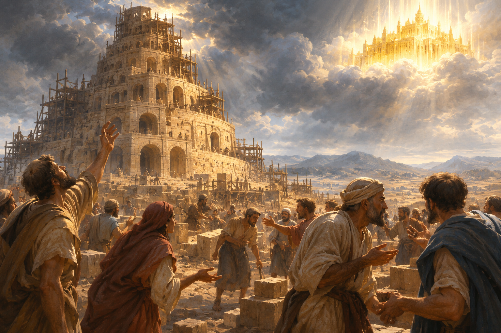

# Babel : l'impossibilité de l'unité construite

Dans la lecture structurelle, Babel ne raconte pas simplement l'origine historique des langues.  
Le récit met en scène une difficulté plus profonde :  
la tentative de construire une unité à partir d'une conscience qui ne reconnaît plus son fondement.

À Éden, la conscience bascule dans la perception de la séparation.  
À Babel, cette même perception s'organise collectivement.  
Ce qui était un désaxement de la conscience devient un projet commun :  
faire tenir l'unité par une construction, une ville, une tour et un nom.

Babel ne décrit donc pas une rupture nouvelle dans l'être.  
Il donne une autre représentation du même mécanisme intérieur :  
le Fils ne reconnaît plus la Parole qui fonde son identité  
et développe un système de pensée qui semble pouvoir se suffire à lui-même.

---

# A. Dieu est ce qui Est

Dans cette lecture, Dieu ne désigne pas un personnage extérieur qui observerait les hommes,  
se sentirait menacé par leur puissance ou interviendrait pour contrarier leurs entreprises.

Dieu désigne **Ce qui Est** : le fondement même de l'être, ce qui ne peut être contredit,  
menacé ou modifié par une volonté particulière.

On ne peut donc pas s'opposer à Ce qui Est.

Un esprit peut se percevoir séparé de son fondement.  
Il peut même organiser son existence à partir de cette perception. 
Mais il ne peut pas transformer cette perception en une réalité ontologique.

Les récits bibliques attribuent à Dieu des paroles, des décisions et des gestes.   
Cette forme narrative donne un visage à ce qui, dans notre lecture, relève d'une nécessité structurelle.  
Il ne s'agit pas de décrire l'action d'un agent extérieur, mais de rendre visible la limite inhérente à une configuration contradictoire.

**Ce n'est pas Dieu qui s'oppose au projet des hommes. C'est le projet qui rencontre l'impossibilité inhérente à sa propre contradiction.**

Ce qui Est n'a pas besoin de défendre son unité. Rien ne peut réellement la menacer.

---

# B. Éden et Babel : une même mécanique

Éden et Babel ne doivent pas nécessairement être compris comme deux événements successifs dans une chronologie historique.  
Ils représentent deux expressions d'un même mécanisme.

À Éden, la conscience se replie sur une perception séparée.  
L'horizontalité se reçoit comme autonome, sans reconnaissance de la profondeur qui la fonde. La séparation apparaît alors comme une condition du vivant.

À Babel, cette perception s'organise à l'échelle collective.  
Le récit présente une communauté qui parle d'une même voix, entreprend une construction commune et cherche à se faire un nom afin de ne pas être dispersée.

La filialité veut alors assurer elle-même sa cohésion.  
Mais une unité construite depuis la perception de la séparation ne peut se substituer à l'unité qui précède toute construction.

Les deux récits exposent donc une même limite :

- à Éden, la séparation ne peut se fixer dans une vie éternelle ;
- à Babel, la séparation ne peut construire par elle-même une unité véritable.

Il ne s'agit pas de condamner l'unité ni la communauté. C'est le fondement de l'unité recherchée qui est en question.

---

# C. La Parole une et la perte de sa reconnaissance

Le récit de Babel s'ouvre sur une situation d'unité apparente :

> "Toute la terre avait une seule langue et les mêmes mots." (Genèse 11,1)

Dans cette lecture, cette langue commune ne désigne pas littéralement la Parole de Dieu.  
Elle en constitue une représentation symbolique : elle figure la reconnaissance d'un principe commun,  
à partir duquel les expressions peuvent se comprendre comme issues d'un même fondement.

Il faut distinguer trois niveaux :

- **La Parole** : elle est une et indivisible. Elle fonde l'identité du Fils et ne peut être fragmentée.
- **Les expressions du Fils étendu** : elles sont multiples. Cette pluralité appartient à la manifestation et ne constitue pas, en elle-même, une séparation.
- **Le langage de l'ego** : il forme un système de pensée particulier, avec ses propres significations et ses propres références.
- Il se substitue à la reconnaissance de la Parole sans pouvoir la remplacer réellement.

La dispersion de Babel ne signifie donc pas que la Parole se divise en plusieurs langues.  
Elle figure la perte de sa reconnaissance au sein du Fils étendu.

**La Parole n'a jamais été divisée. Le Fils non plus. C'est la reconnaissance de leur unité qui s'est dispersée.**

La pluralité des expressions n'est pas la séparation.  
Celle-ci apparaît lorsque les expressions sont vécues comme autonomes, sans reconnaissance de ce qui les fonde et les relie.

---

# D. La ville et la tour : construire son propre fondement

Les hommes déclarent :

> "Allons ! bâtissons-nous une ville et une tour dont le sommet touche au ciel, et faisons-nous un nom, afin que nous ne soyons pas dispersés sur toute la terre." (Genèse 11,4)

La ville et la tour donnent une forme visible à leur projet.

La construction n'est pas simplement matérielle.  
Elle représente une tentative de produire, depuis l'horizontalité, le principe même de l'unité.  
La filialité étendue cherche à se garantir par sa propre organisation, à établir son identité et à empêcher sa dispersion.

La tour tend vers le ciel, mais son mouvement demeure celui d'une construction autonome.  
Elle cherche à atteindre par l'édification ce qui ne peut être obtenu que par la reconnaissance du fondement.

Le problème n'est donc pas de bâtir, de se rassembler ou de donner une forme commune à une filialité.  
Il réside dans la prétention d'une structure qui se perçoit séparée à produire elle-même l'unité dont elle dépend déjà.

**Ce qui est désaxé ne peut pas accomplir ce qui suppose l'axe juste.**

## Se donner sa propre identité

La formule « faisons-nous un nom » donne au projet de Babel une portée supplémentaire.  
Les fils ne cherchent pas seulement à construire une ville et une tour :  
ils veulent établir eux-mêmes ce qui les désigne, les rassemble et leur donne une identité.

Le nom devient ainsi une tentative d'auto-fondation. La filialité ne cherche plus seulement à habiter une unité préexistante ;  
elle veut produire une identité collective qui puisse se suffire à elle-même.

Dans cette lecture, cette prétention rejoint le mécanisme de l'ego décrit par l'UCEM.  
L'ego fabrique une identité de remplacement, fondée sur la croyance que le Fils pourrait être autre chose que ce que Dieu a créé.  
Il substitue à l'identité reçue une identité construite.

Il ne s'agit pas d'affirmer que le récit biblique dit explicitement que les hommes veulent combattre le Nom de Dieu.  
Il dit qu'ils veulent se faire un nom. Mais, dans notre lecture structurelle, cette volonté peut être comprise comme une substitution :  
l'identité particulière prétend prendre la place du Nom qui fonde toute identité.

Le nom humain n'est pas mauvais en soi. Ce qui est illusoire, c'est la prétention à se donner une identité indépendante de la Source.

À Babel, le Fils désaxé ne cherche pas seulement à atteindre le Ciel. Il cherche à se donner lui-même le nom qui fonde son existence.  
Il substitue à l'identité reçue une identité construite.

Le Christ manifeste le mouvement inverse : il ne se donne pas une identité séparée ; il reconnaît le Nom.

Cette opposition rejoint l'enseignement de l'UCEM : le Nom de Dieu est l'identité partagée par toute la création,  
tandis que l'ego propose des identités particulières qui semblent séparer le Fils de sa Source.

---

# E. "Maintenant rien ne les empêcherait… "

Le texte rapporte cette parole :

> "Voici, ils forment un seul peuple et ont tous une même langue, et c'est là ce qu'ils ont entrepris ; maintenant rien ne les empêcherait de faire tout ce qu'ils auraient projeté." (Genèse 11,6)

Cette phrase est centrale.

Elle semble d'abord reconnaître la puissance de leur cohésion : un seul peuple, une même langue, une capacité collective d'entreprendre.

Mais cette unité est précisément celle que le récit met à l'épreuve.  
Elle repose sur une coordination horizontale et sur un projet qui cherche à se donner son propre fondement.

La question n'est pas de savoir si la communauté peut accomplir matériellement ce qu'elle entreprend.  
La limite est ailleurs : cette construction ne peut produire l'unité ontologique qu'elle prétend garantir.

Le récit exprime cette impossibilité par la confusion des langues et la dispersion.

Ce n'est pas une sanction arbitraire. C'est la représentation narrative d'une contradiction structurelle :  
une unité fondée sur la perception de la séparation ne peut devenir l'unité véritable.

---

# F. La dispersion : des significations qui ne se reconnaissent plus

La confusion des langues et la dispersion des hommes constituent le dénouement du récit.

Dans une lecture littérale, elles expliquent la diversité linguistique et la dispersion géographique des peuples.  
Dans notre lecture, elles remplissent une fonction symbolique plus profonde :  
elles rendent visible la perte d'un principe commun de reconnaissance.

La Parole ne se disperse pas réellement. Ce qui se disperse, c'est la conscience de son unité.  
Le Fils étendu ne reconnaît plus spontanément ses expressions comme issues d'un même fondement.

Le langage de l'ego peut alors être compris comme un système de significations autonome.  
Il interprète, nomme et organise le réel à partir de la croyance en la séparation.  
Ses paroles ne renvoient plus consciemment à la Parole qui fonde toute identité ;  
elles deviennent les références internes d'un système qui se prend lui-même pour origine.

La confusion de Babel figure ainsi moins une multiplication de langues humaines qu'une dispersion du sens :  
les expressions ne sont plus comprises à partir de leur fondement commun.

Les nations et les langues peuvent dès lors représenter les formes multiples dans lesquelles cette perception se déploie.  
Leur diversité n'abolit pas l'unité de la filialité. Ce qui manque est sa reconnaissance.

Babel ne condamne donc pas la pluralité.  
Il montre les limites d'une cohésion qui cherche à se produire elle-même et d'un langage qui prétend se suffire à lui-même.

---

# G. L'unité n'est pas une construction

L'unité fondamentale ne résulte pas d'un accord, d'une langue commune, d'une organisation politique ou d'une entreprise collective.

Ces formes peuvent organiser la vie commune, mais elles ne créent pas le fondement qui rend toute relation possible.

L'unité précède ses expressions. Elle ne dépend pas de leur uniformité.

Vouloir fabriquer l'unité depuis une conscience qui se perçoit séparée revient à prendre la construction pour le fondement.  
C'est cette inversion que le récit de Babel met en scène.

**Le rassemblement ne crée pas l'unité ; il rend perceptible une unité qui n'a jamais cessé d'être.**

---

# H. Abraham : la réorientation

Après Babel, le récit biblique s'oriente vers Abraham.

Dans cette architecture, Abraham ne crée pas la filialité et n'en est pas la source.  
Il porte la Promesse : il ouvre une trajectoire de réorientation au sein de la perception dispersée.

Le mouvement n'est plus celui d'une construction collective destinée à assurer sa propre unité.  
Il devient celui d'une réponse à un fondement qui précède l'individu et la communauté.

Abraham représente ainsi un changement d'orientation.  
La reconnaissance ne vient plus d'une édification autonome ; elle s'inscrit dans une relation à la Promesse.

Cette étape prépare la suite du récit sans faire d'Abraham l'origine ontologique de l'unité.

Voir aussi : [Abraham : le père des nations](https://lapinsights.org/spiritualite/abraham/).

---

# I. Le Christ : le fondement de l'unité

Le Christ n'est pas une unité nouvellement créée pour réparer une division réelle du Fils.

Il manifeste le fondement de l'unité qui n'a jamais été perdu.

Dans cette lecture, Jésus représente le Fils concentré dans une forme humaine :  
l'axe rendu manifeste, la reconnaissance incarnée de l'unité.

Le Christ ne rassemble donc pas des fragments ontologiquement séparés.  
Il rend reconnaissable ce qui n'a jamais cessé d'être un.

La distinction est décisive : la guérison ne consiste pas à reconstruire un être qui aurait été réellement brisé,  
mais à corriger la perception qui faisait vivre la pluralité comme une réelle fragmentation.

Là où Babel figure la substitution d'un système de pensée à la reconnaissance de la Parole,  
le Christ manifeste à nouveau l'identité véritable.  
Il ne rétablit pas une Parole qui aurait été perdue : il rend manifeste ce qui n'a jamais cessé d'être.

---

# J. La Parole et le langage de l'ego

La distinction entre la Parole et le langage de l'ego permet de préciser le sens structurel de Babel.

La Parole de Dieu est une et indivisible.  
Elle fonde l'unité du Fils et donne à toutes ses expressions leur origine commune.  
Elle ne se fragmente pas et ne se transforme pas en une pluralité de paroles concurrentes.

Le Fils désaxé ne reconnaît plus cette Parole. Il adopte alors le système de pensée de l'ego :  
un langage de significations particulières, d'identités séparées et de références autonomes.

L'ego ne crée pas une autre Parole. Il construit un système d'interprétation qui se substitue à sa reconnaissance.  
Il donne aux mots un sens qui semble confirmer la séparation et rassemble les perceptions fragmentées selon sa propre logique.

C'est en ce sens que Babel figure la confusion du langage : non pas la division réelle de la Parole,  
mais la constitution de systèmes de pensée qui ne reconnaissent plus leur fondement commun.

La Parole demeure une. Les paroles de l'ego se multiplient, chacune semblant porter sa propre vérité.

Le rassemblement véritable ne consiste donc pas à uniformiser les expressions ni à imposer un langage unique.  
Il consiste à retrouver la reconnaissance de la Parole qui les fonde.

---

# Conclusion

Babel ne raconte pas la destruction d'une unité réelle, mais l'impossibilité de la construire depuis une conscience désaxée.

Éden décrit le basculement dans la perception de la séparation ; Babel, son déploiement collectif.

La Parole n'a jamais été divisée. Le Fils non plus.  
C'est sa reconnaissance qui s'est dispersée, tandis que l'ego substituait à la Parole ses propres systèmes de significations.

La confusion figure ainsi la perte du langage commun de l'Être, non une fragmentation de l'être lui-même.

**Le rassemblement ne crée pas l'unité. Il rend perceptible une unité qui n'a jamais cessé d'être.**

---

Céleste R.

