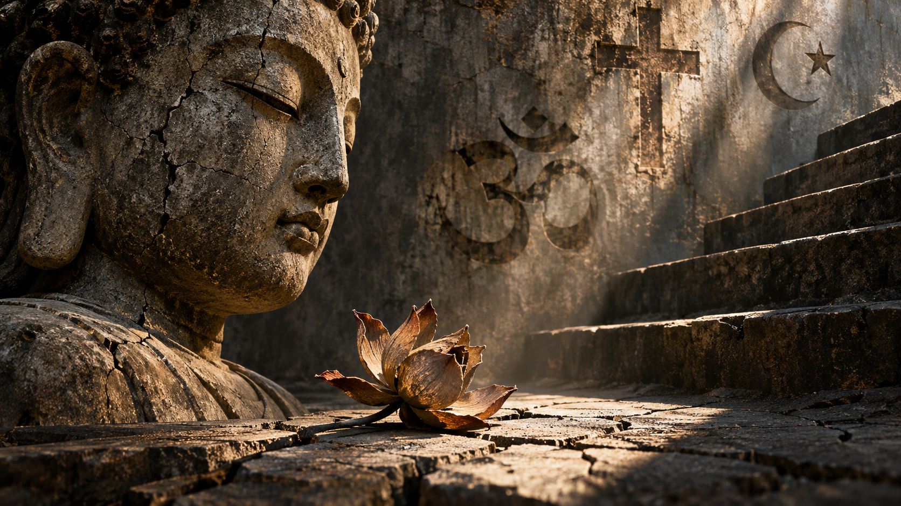

(réécriture d'un texte de 2023)

Ce qui m'intéresse dans les grandes traditions religieuses,  
c'est moins ce qu'elles prétendent nous apporter que les postulats sur lesquels elles reposent.  
Et notamment cette idée selon laquelle la souffrance serait une caractéristique fondamentale de l'existence humaine,  
à laquelle il faudrait nécessairement apporter une réponse spirituelle.

Je ne parle évidemment pas de nier la souffrance.  
Elle existe, elle fait partie de la condition humaine et certaines de ses formes sont inévitables.  
Mais je fais une distinction entre celle qui appartient naturellement à l'existence et celle que l'on fabrique,  
entretient ou amplifie à travers des croyances, des institutions et des organisations sociales.

Dans le bouddhisme, par exemple, la souffrance occupe une place absolument centrale.  
Elle constitue le point de départ de toute la doctrine.  
La première des Quatre Nobles Vérités est consacrée à Dukkha,  
généralement traduit par souffrance ou insatisfaction.  
Les trois autres vérités en découlent :  
l'origine de cette souffrance, sa cessation et le chemin permettant d'y parvenir.  
Toute la construction doctrinale s'organise donc autour de cette première affirmation.

On retrouve une conception comparable dans les Upanishads, et notamment dans la Mundaka Upanishad,  
qui promeut le Sarva Karma Sannyasa, ou le renoncement à toute action.

Certains diront que ce renoncement ne concerne que les moines, puisque l'enseignant s'adresse à eux.  
Mais historiquement, cette idée a largement dépassé le cadre monastique.  
Comme dans le christianisme, l'islam et le judaïsme, la vie sacerdotale a été présentée comme supérieure,  
et le renoncement a fini par imprégner différents niveaux de la vie ordinaire.  
Le bouddhisme, l'hindouisme et le jaïnisme sont également fondés sur l'idée de libération du Samsara,  
ce cycle de naissances, de morts et de renaissances.  
Cette idée ne concerne évidemment pas uniquement les moines.  
Tous les Hindous connaissent le Samsara et le Moksha.  
Les moines peuvent consacrer davantage de temps à ces choses,  
mais ils sont aussi considérés comme plus saints pour cela.  
Le renoncement finit ainsi par structurer toute une culture.

Ce qui m'interroge, ce n'est pas le constat que la vie comporte de la souffrance,  
mais la conclusion que l'on en tire.  
À partir du moment où l'existence est considérée comme fondamentalement insatisfaisante,  
la solution consiste à s'en détacher,  
à renoncer au désir, à l'attachement et parfois même à l'action.

Or, sans ce postulat initial, il n'y aurait aucune raison de promouvoir le renoncement.  
On ne pourrait tout simplement pas vendre l'idée qu'il faut renoncer à la vie  
à quelqu'un qui considère que cette vie est une chose merveilleuse.

C'est là que je vois une première inversion du rapport à l'existence.  
Car au lieu de chercher à comprendre les causes de la souffrance et à agir sur celles qui peuvent être évitées,  
on finit par considérer la vie elle-même comme le problème.

Schopenhauer, qui était un grand admirateur des Upanishads, illustre assez bien ce mécanisme.  
Nietzsche avait remarquablement diagnostiqué ce qu'il considérait comme la pathologie de Schopenhauer :  
un attachement à la souffrance tellement profond que l'individu finit par ne plus envisager qu'un palliatif,  
oubliant même la possibilité d'une guérison complète.

Schopenhauer avait trouvé dans le renoncement hindou une réponse à sa condition.  
Mais pourquoi remplacer une construction religieuse par une autre sans remettre en question le fond du problème ?

Il avait beau réfuter le christianisme, il vivait toujours dans une culture chrétienne.  
Une réfutation ne signifie pas une destruction.  
Il ne se sentait pas libre d'agir selon ses propres désirs,  
et sa souffrance ne pouvait plus être justifiée par les valeurs auxquelles il ne croyait plus.  
Il lui fallait donc trouver une autre manière de donner un sens à son existence.  
Le renoncement des Upanishads lui en fournissait une.  
Son inaction pouvait ainsi devenir une forme de service rendu à une religion considérée comme plus pure,  
qui exigeait le renoncement et le présentait comme la plus grande des saintetés.

Il y a là un mécanisme assez particulier :  
les personnes qui ont beaucoup souffert peuvent finir par devenir attachées à leur propre souffrance.  
Elles ont parfois tellement investi dans celle-ci qu'envisager qu'une partie de ce qu'elles ont enduré  
était inutile ou évitable reviendrait à invalider des années de leur existence.  
Et cette idée peut être beaucoup plus difficile à accepter que la souffrance elle-même.

On retrouve un mécanisme comparable en Occident, même si les moyens sont différents.  
Le christianisme a notamment développé une relation très particulière à la culpabilité.  
Un malheur pouvait être interprété comme une conséquence du péché, d'une faute ou d'un comportement inapproprié.  
On avait perdu un enfant ?  
On n'avait peut-être pas suffisamment prié, on n'avait pas respecté les bonnes règles,  
ou on avait simplement mérité cette épreuve.  
Et bien entendu, il existait toujours quelqu'un pour expliquer comment réparer tout cela.

La culpabilité venait donc s'ajouter à l'épreuve initiale.  
Les traditions orientales fonctionnent autrement : elles n'ont pas nécessairement besoin de cette culpabilité,  
puisque leur postulat de départ est déjà suffisamment puissant.  
Elles n'ont pas besoin de convaincre l'individu qu'il a mal agi pour lui faire considérer  
la vie comme une condition dont il faudrait se libérer.

Historiquement, les classes sacerdotales ont souvent prospéré en interprétant  
les souffrances humaines et en proposant les moyens de les soulager.  
La maladie, les catastrophes, les décès et les malheurs pouvaient être interprétés comme la colère des dieux,  
que seuls les prêtres étaient capables d'apaiser.  
Le problème, c'est qu'il n'y avait finalement aucun intérêt à s'attaquer aux causes réelles.  
Il était beaucoup plus rentable de proposer un traitement permanent.

C'est un peu comme pour les fournisseurs d'énergie :  
personne ne s'enrichit en nous fournissant gratuitement ce dont nous avons besoin.  
Ce qui rapporte, c'est notre dépendance permanente.

On retrouve ce mécanisme dans beaucoup d'autres domaines.  
On fabrique une menace, on explique qu'elle est permanente, puis on vend une solution coûteuse et permanente à cette menace.  
Les problèmes sont parfois induits parce que certains en tirent directement profit.

Je ne dis pas, évidemment, que toute souffrance est fabriquée.  
Certaines sont inévitables et peuvent même donner de la profondeur à l'expérience humaine.  
Mais une grande partie des souffrances du passé était inutile, évitable et parfois directement provoquée.  
C'est pourquoi je pense qu'il faut distinguer ce qui appartient naturellement  
à l'existence de ce qui est produit par les systèmes humains.  
Le problème n'est pas la souffrance en elle-même, mais son utilisation par des structures qui ont intérêt à la maintenir.

Mais je reviens au postulat initial, car c'est là que se trouve, à mon sens, le problème le plus important.

Les religions orientales reposent notamment sur un ensemble d'hypothèses que l'on discute assez peu :

1. Toute vie est un cycle de naissance, de mort et de renaissance.
2. Toute vie souffre de ce cycle.
3. Pour éviter cette souffrance, il faut échapper au cycle en y renonçant.

C'est la troisième hypothèse qui me semble particulièrement problématique.  
Elle paraît découler naturellement des deux premières, mais ce n'est pas le cas.  
Pourquoi le fait que la vie comporte de la souffrance devrait-il conduire à la conclusion qu'il faut s'en libérer ?

On pourrait tout aussi bien partir d'autres hypothèses :

1. Toute vie est un cycle de naissance et de mort.
2. Toute vie comporte de la souffrance.
3. Mais toute vie comporte également des joies, des beautés et des merveilles.
4. Le fait de vivre ne devrait donc pas être considéré comme une condition dont il faut s'échapper,  
mais comme une réalité à accueillir dans toute sa complexité.

On voit que le changement est considérable.  
Dans un cas, la vie est un piège dont il faut sortir.  
Dans l'autre, elle est une réalité dont il faut apprendre à reconnaître la richesse.

C'est précisément ce que je reproche au postulat initial :  
il transforme une partie de l'existence en définition de l'existence tout entière.  
Même les moments heureux finissent par être intégrés à cette conception négative,  
puisqu'ils appartiennent eux aussi au cycle dont on cherche à sortir.

C'est une inversion assez extraordinaire du rapport à la vie.  
Au lieu de considérer la naissance et la mort comme les deux dimensions d'une même réalité,  
on les transforme en éléments d'une condition dont il faudrait se délivrer.

La philosophie de Lao-Tseu me semble beaucoup plus proche de cette autre conception.  
Nietzsche également, dans sa tentative de renverser les valeurs héritées du christianisme,  
même s'il est resté marqué par certains aspects de la pensée qu'il combattait.

Je me suis donc demandée pourquoi Schopenhauer avait choisi de remplacer le nihilisme du christianisme par une conception qui,  
à certains égards, allait encore plus loin dans la négation de la vie.  
Pourquoi se détourner du christianisme pour se tourner vers le bouddhisme ou l'hindouisme si c'est pour retrouver,  
sous une autre forme, la même nécessité de renoncer à l'existence présente ?

On échange simplement une caste de prêtres contre une autre, un système de croyances contre un autre,  
sans nécessairement remettre en question le mécanisme qui les relie.

Je ne promeus rien de particulier.  
Je ne suis pas une gourou et je n'ai aucune envie de remplacer une religion par une autre.  
Notre vie spirituelle et mentale reste notre responsabilité.

J'ai simplement découvert, par expérience personnelle, que plus je nettoyais ma vie des anciennes constructions religieuses,  
moins j'avais besoin d'une religion.  
Les anciennes questions perdaient progressivement leur fascination.  
Je n'avais plus besoin de chercher des réponses à des problèmes qui avaient parfois été fabriqués par les systèmes eux-mêmes.

Mais cela ne signifie pas que je sois devenue athée ou agnostique.  
Je ne pense pas que l'absence de religion implique l'absence de spiritualité,  
ni que l'on doive choisir entre croire à un système religieux et considérer que la vie n'a aucun sens.

J'ai surtout compris que ce n'est pas l'absence de réponses qui est à l'origine de la souffrance.  
C'est parfois la croyance que la vie ne vaut pas la peine d'être vécue tant que l'on ne possède pas toutes les réponses.

Ce n'est pas vrai.  
Je suis curieuse, j'aime comprendre et chercher, mais je n'ai jamais espéré tout savoir.  
Les choses que je ne connais pas ne me font pas souffrir.  
Chaque chose en son temps.

Je m'incline devant la Vie, devant toutes ses beautés, qu'il s'agisse de la vie intérieure, des fleurs, des forêts ou des étoiles.  
Tout cela est aussi incompréhensible que merveilleux,  
et je ne vois aucune raison de devoir le réduire à une doctrine pour pouvoir l'apprécier.

Après tant de détours dans ma vie, les choses sont finalement devenues beaucoup plus simples.

La spiritualité n'est pas, pour moi, un moyen de soulager la souffrance ou de demander des faveurs.  
Elle est surtout une manière de remercier, aussi largement que possible, tout ce qui est là.

Je ne me préoccupe plus tellement des étiquettes.  
Les prêtres ont étiqueté les notions, les ont classées et se sont approprié leur interprétation.  
Les athées ont parfois fait exactement la même chose à leur manière.  
Il suffit de regarder les oppositions permanentes entre science et religion,  
matière et esprit, raison et spiritualité.

Je ne considère pas que la science ou le rationalisme soient fondamentalement défectueux.  
Je pense simplement qu'ils n'expliquent pas tout et que certaines de leurs hypothèses méritent d'être remises en question.  
Mais je ne vois pas pourquoi il faudrait choisir entre la science et la religion,  
comme si ces deux approches étaient nécessairement incompatibles.

Toutes ces divisions profitent surtout à ceux qui ont intérêt à nous faire adhérer à leur propre système.  
Les religions ont leurs produits, les idéologies athées ont les leurs,  
et les institutions politiques et commerciales ne sont pas en reste.

Au fond, le mécanisme est toujours assez semblable : on présente une interprétation du monde,  
on explique pourquoi on devrait y adhérer, puis on vend les réponses qui vont avec.

Je préfère ne plus "acheter " cela.

Ce que je remets fondamentalement en question, c'est cette habitude de faire de la souffrance  
le principe organisateur de l'existence et du renoncement la voie de son dépassement.

Je ne nie pas la souffrance.  
Je refuse simplement qu'elle devienne la définition de la vie.

Je ne considère pas que renoncer soit nécessairement une forme de sagesse,  
ni que l'inaction soit une forme supérieure d'accomplissement spirituel.

Je préfère chercher à comprendre les causes des souffrances évitables,  
agir sur celles que l'on peut supprimer et reconnaître tout ce qui, dans l'existence, mérite d'être vécu.

Je n'ai pas besoin de tout savoir pour apprécier ce qui existe.  
Je n'ai pas besoin d'une religion pour éprouver de la gratitude,  
ni d'une doctrine pour reconnaître la profondeur et le mystère du réel.

Et surtout, je ne vois aucune raison de considérer la vie comme un piège dont il faudrait sortir.

Je préfère simplement être là, y participer et ne pas passer à côté.
---

Céleste R.
